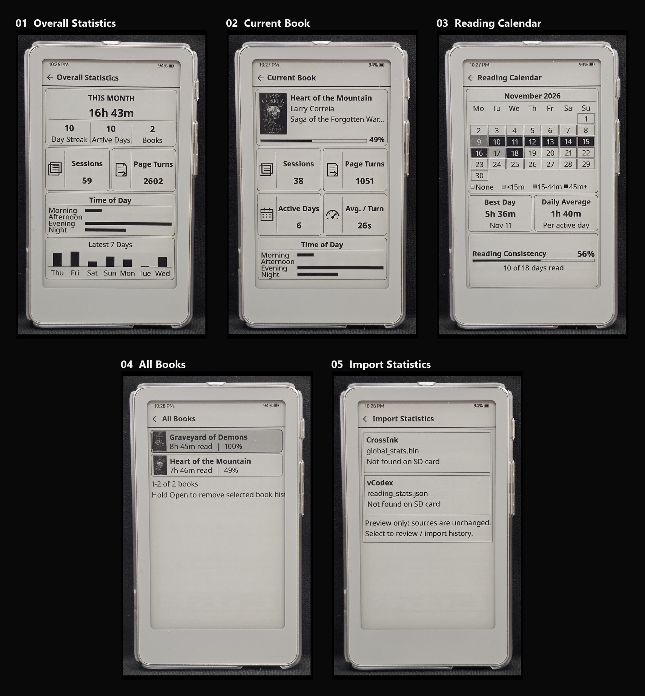

# Reading Statistics — CrossPoint Plugin

An optional **offline, on-reader** Reading Statistics dashboard for compatible firmware. This repository holds the separately installable plugin payload. The firmware owns the native BIN statistics store and import engine; the plugin defines the dashboard's six pages, metric labels and widgets.

## Dashboard preview

[](assets/screenshots/reading-statistics-contact-sheet.jpg)

Five real device photos in capture order (oldest first), cropped with the **entire reader and a small black border** intact, and scaled to the same height. Select the contact sheet to enlarge it, or view each photo: [Overall Statistics](assets/screenshots/01-overall-statistics.jpg) · [Current Book](assets/screenshots/02-current-book.jpg) · [Reading Calendar](assets/screenshots/03-reading-calendar.jpg) · [All Books](assets/screenshots/04-all-books.jpg) · [Import Statistics](assets/screenshots/05-import-statistics.jpg). The sixth dashboard page, **Your Week**, is not included in this photo set.

## Installable payload

```text
reading-statistics.crosspoint-plugin/
  manifest.json
  device.json
  README.md
  DETAILS.md
  icons/
    book.pbm
    clock.pbm
    sessions.pbm
    turns.pbm
    calendar.pbm
    bars.pbm
    speed.pbm
```

The installed directory is **`/.crosspoint/plugins/reading-statistics/`** (not the source repository folder name). Put all declared manifest files, including the `icons/` folder, in that directory. The alternative `/plugins/reading-statistics/` location is also supported by compatible firmware.

The plugin is **device-only**. It has no `plugin.js`, does not require Wi-Fi or an account, and does not expose local reading records through a browser. The six-page native dashboard is available only when firmware advertises **both `stats.native.v1` and `ui.dashboard.v2`**. Compatibility is based on these capabilities, not firmware branding or version. The `reading-stats.v1` source/schema remains unchanged: `ui.dashboard.v2` identifies the expanded widget renderer, not a new persisted format. **Known compatible firmware:** Razor-Crest builds exposing both capabilities; other firmware with the same capabilities can also run this plugin.

The dashboard's six pages use concise labels and a compact grayscale layout. Metric cards can display their own icons, divider lines and rounded or chamfered borders; a featured hero card spans the page width. Overall Statistics removes duplicated Reading Time and Active Days cards, shows compact Sessions/Page Turns cards, and adds a time-of-day chart. Current Book has its own time-of-day breakdown; Your Week uses the latest seven recorded reading days. The firmware records local session-start time buckets in separate small files, so older/imported history remains intact without invented times. Morning is 06:00-11:59, Afternoon 12:00-16:59, Evening 17:00-20:59, and Night 21:00-05:59. The firmware renders the current pre-release V1 dashboard contract. Current Book metadata wraps across lines rather than being forced into a single truncated row. "Page Turns" means qualified forward turns, not unique pages. The seven-day chart ends on the latest recorded reading day. Reading Calendar uses the current device-local month, with numbered, shaded dates and Best Day, Daily Average, and Reading Consistency insights. It uses existing daily readings and does not repeat the old lifetime Active Days metric.

The optional import page accepts CrossInk and vCodex history and uses a two-step confirmation. Originals are preserved, and each legacy source/book is imported at most once. Stock CrossPoint `develop` has no native historical reading-statistics database to migrate; saved book progress cannot reproduce reading duration or session counts. For test fixtures or advanced storage details, see the firmware's `docs/reading-stats-plugin-architecture.md`.

## Optional Home shortcut

On firmware exposing `home.shortcuts.v1`, the plugin can register a **Reading Statistics** Home button that opens the same six-page native dashboard. Manage visible buttons and free space through **Settings > Display > Home Menu Buttons**. Firmware without this optional shortcut primitive still supports launching from **Home > Plugins** when it exposes the required statistics/dashboard capabilities. Uninstalling the plugin removes its shortcut without deleting reading records.

## Publishing

This repository follows the Plugin Hub standalone-plugin contract. The public GitHub repository, `crosspoint-plugin` topic, and a stable GitHub Release tag matching the version in `manifest.json` make the plugin eligible for automatic catalog discovery. The manifest declares the required capabilities so unsupported firmware is filtered out. No GitHub access is required for local sideloading.

## Validate locally

```powershell
python tests/test_package.py
```

To build the optional SD-card-root ZIP locally:

```powershell
python tools/package.py
```

The generated archive contains `plugins/reading-statistics/` and is deliberately not committed.
